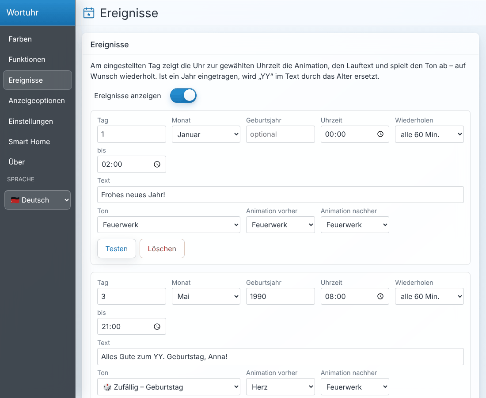
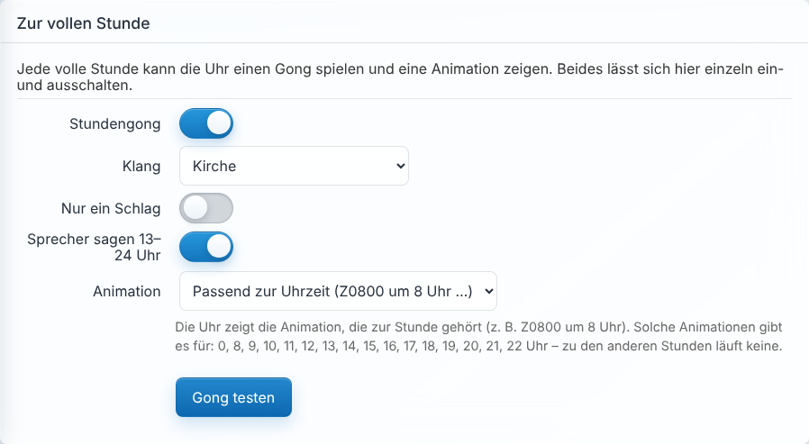
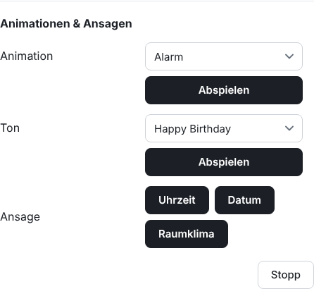
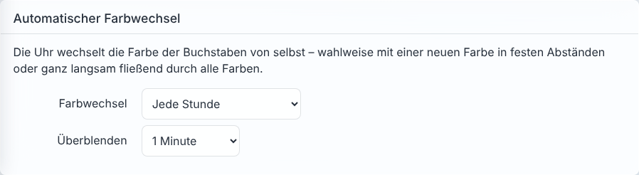
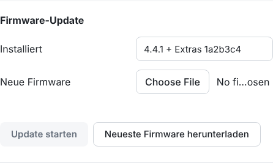
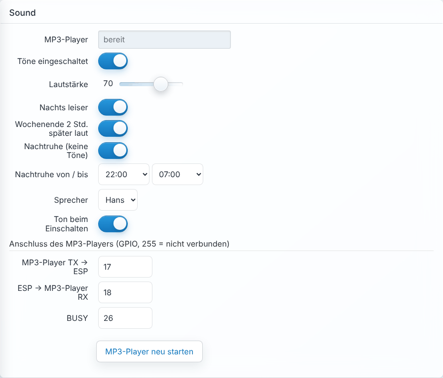
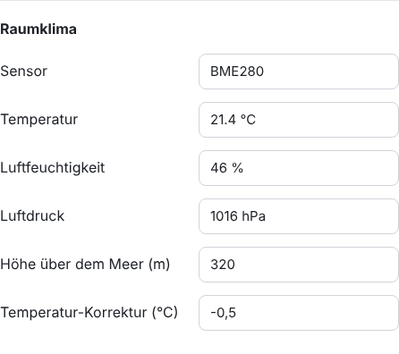
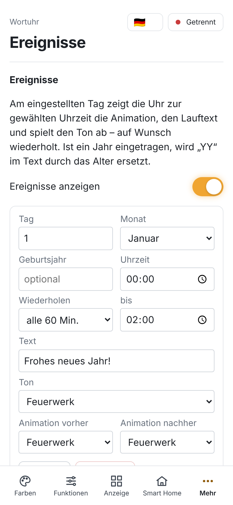
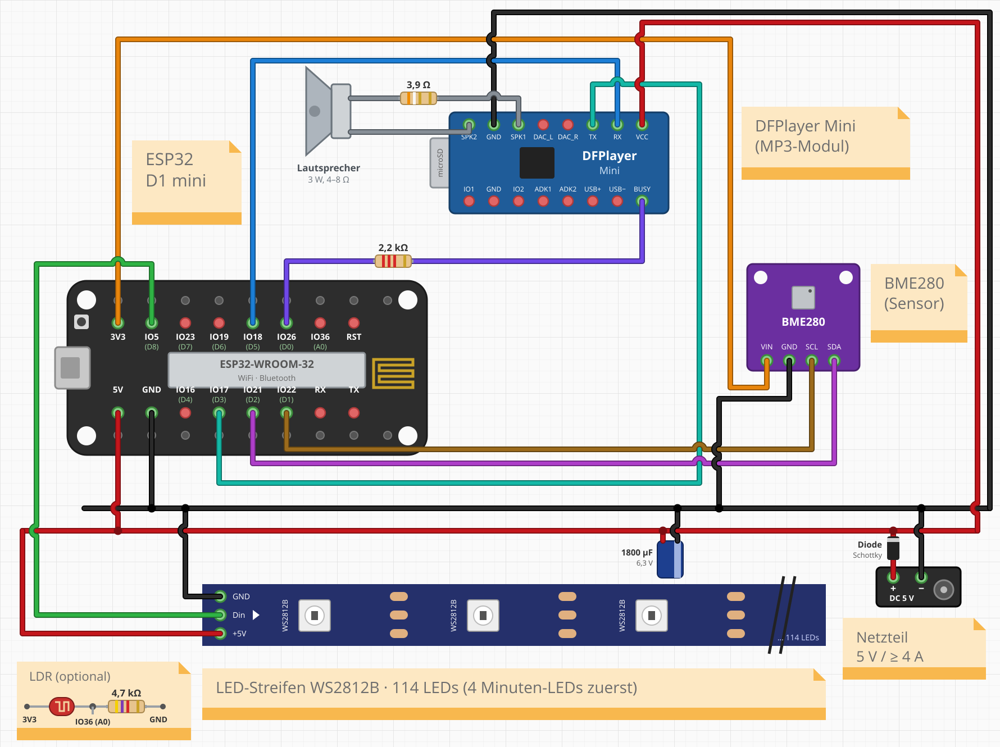

# Wortuhr mit Sound, Animationen & Home Assistant

[](https://github.com/maxlin1/ESP-Wordclock-mit-Audio-und-Animationen/actions/workflows/firmware-esp32.yml)
[](https://github.com/maxlin1/ESP-Wordclock-mit-Audio-und-Animationen/releases/latest)

Dieser Fork von [ESPWortuhr](https://github.com/ESPWortuhr/Multilayout-ESP-Wordclock) bringt die Funktionen der Wortuhr **Wortuhr_mp3 von Manfred Hofmann** auf einen **ESP32**: Töne und Ansagen über einen DFPlayer Mini, die 58 Animationen, Ereignisse wie Geburtstage und ein Raumklima-Sensor – alles direkt in der Weboberfläche der Uhr und per MQTT in Home Assistant.

Die Hardware einer bestehenden Wortuhr_mp3 (WeMos D1 mini, DFPlayer, BME280) kann weiterverwendet werden: Statt des WeMos D1 mini steckt einfach ein **ESP32 D1 mini** im selben Sockel. Die SD-Karte mit den Sounds bleibt unverändert. Die Erweiterungen gibt es nur für den ESP32; auf dem ESP8266 verhält sich die Firmware wie das Original-Projekt.

**Inhalt:** [Neue Funktionen](#neue-funktionen) · [Weboberfläche](#weboberfläche) · [Hardware](#hardware-und-schaltbild) · [Layouts und Sounds](#layouts-und-sounds) · [Installation](#installation) · [Einrichten](#einrichten) · [Updates](#updates) · [Home Assistant](#home-assistant) · [Zurück zur alten Firmware](#zurück-zur-alten-firmware) · [Lizenz](#danke--lizenz)

## Neue Funktionen

| | |
|---|---|
| 🔔 **Stundengong** | 17 Klänge (Kirche, Westminster, Kuckuck, Vicki/Hans …), pro Wochentag wählbar, Einzelschlag oder Stundenzahl |
| 🗣️ **Ansagen** | Uhrzeit, Datum und Raumklima mit den Sprechern Vicki oder Hans |
| 🎞️ **Animationen** | alle 58 Animationen der alten Uhr (Herz, Feuerwerk, Kerze, Pacman …), fest in der Firmware |
| ⏰ **Zur vollen Stunde** | Animation passend zur Uhrzeit (`Z0800` um 8 Uhr …), eine zufällige oder eine bestimmte Animation |
| 🎂 **Ereignisse** | Geburtstage, Feiertage usw. mit Uhrzeit, Ende, Wiederholung, Lauftext (Alter über „YY“), Ton und Animationen; Import der `events.json` der alten Uhr |
| 🎲 **Zufallstöne** | ein zufälliger Titel aus Geburtstag, Weihnachten, Silvester, Natur, Tiere oder Musik |
| 🌈 **Automatischer Farbwechsel** | neue Farbe alle 5 Minuten, stündlich oder täglich – sanft überblendet – oder fließend durch alle Farben |
| 🔊 **Sound-Einstellungen** | Lautstärke, nachts leiser, Wochenende später laut, Nachtruhe; keine Töne, wenn die Uhr aus ist |
| 🌡️ **Raumklima** | Temperatur, Luftfeuchte und Luftdruck mit BME280 / BMP280 |
| 🏠 **Home Assistant** | alles per MQTT mit automatischer Erkennung: Schalter, Auswahlen, Tasten, Sensoren, Nachrichten mit Ton und Animation |
| ⬆️ **Firmware-Update** | in der Weboberfläche mit Fortschrittsanzeige |

## Weboberfläche

Die Erweiterungen sind in die bestehenden Seiten der Uhr eingebaut, Änderungen werden sofort gespeichert.

| Wo | Was |
|---|---|
| **Funktionen → Übergang** | wie die Buchstaben wechseln, wenn sich die Uhrzeit ändert (alle 5 Minuten): Überblenden, Matrix-Regen … („Keines“ = sofort). Gehört zum Original-Projekt. |
| **Funktionen → Zur vollen Stunde** | Stundengong (Klang, auch pro Wochentag) und Animation zur vollen Stunde – beides einzeln ein/aus |
| **Funktionen → Animationen & Ansagen** | Animationen und Töne abspielen, Uhrzeit, Datum und Raumklima ansagen |
| **Ereignisse** | Geburtstage, Feiertage usw.; „events.json importieren“ übernimmt die Ereignisse der alten Uhr |
| **Farben → Automatischer Farbwechsel** | neue Farbe in festen Abständen oder fließend |
| **Einstellungen → Sound** | Lautstärke, Nachtruhe, Sprecher, Anschlüsse des MP3-Players |
| **Einstellungen → Raumklima** | Messwerte, Höhe über dem Meer (für den Luftdruck), Temperatur-Korrektur |
| **Einstellungen → Firmware-Update** | neue Firmware über WLAN einspielen |

**Ereignisse** – eigener Menüpunkt mit Datum, Uhrzeit, Wiederholung, Text, Ton und Animationen:



| Funktionen → Zur vollen Stunde | Funktionen → Animationen & Ansagen |
|---|---|
|  |  |

| Farben → Automatischer Farbwechsel | Einstellungen → Firmware-Update |
|---|---|
|  |  |

| Einstellungen → Sound | Einstellungen → Raumklima | Auf dem Handy |
|---|---|---|
|  |  |  |

## Hardware und Schaltbild



| Funktion | WeMos D1 mini (alt) | ESP32 D1 mini (neu) | Anschluss |
|---|---|---|---|
| LED-Daten | D8 | GPIO 5 | DIN des LED-Streifens |
| ESP → DFPlayer | D5 | GPIO 18 | RX des DFPlayers (direkt) |
| DFPlayer → ESP | D3 | GPIO 17 | TX des DFPlayers (direkt) |
| DFPlayer BUSY | D0 | GPIO 26 | BUSY über 2,2 kΩ (LOW, solange ein Ton spielt) |
| I²C SCL | D1 | GPIO 22 | SCL des BME280 |
| I²C SDA | D2 | GPIO 21 | SDA des BME280 |
| LDR (optional) | A0 | GPIO 36 | Spannungsteiler LDR / 4,7 kΩ |
| Versorgung | 5V / GND | 5V / GND | Netzteil 5 V (≥ 4 A für 114 LEDs) |

**Bauteile auf der Platine** (nach Manfreds Platinenplan `Platine_Plan_Wortuhr_mp3.pdf`):

| Bauteil | Farbringe | sitzt zwischen | wofür |
|---|---|---|---|
| 2,2 kΩ | rot-rot-rot-gold | D0 und BUSY des DFPlayers | Schutzwiderstand in der BUSY-Leitung |
| 3,9 Ω | orange-weiß-gold-gold | SPK1 und Lautsprecher | begrenzt den Strom zum Lautsprecher |
| 4,7 kΩ | gelb-violett-rot-gold | A0 und GND | Spannungsteiler für den LDR (Helligkeitssensor) |
| 2,2 kΩ + 4,7 kΩ | | D7 und Touch-Sensor TTP223 | nur bei Manfreds „Sensor-Modus“; diese Firmware nutzt den Touch-Sensor nicht |
| Elko 1800 µF / 6,3 V | | +5 V und GND | puffert die Versorgung |
| Diode | | Eingang +5 V | Verpolschutz |

Die Datenleitungen zwischen ESP und DFPlayer (RX/TX) haben **keine** Widerstände.

- **ESP32 D1 mini**: Nur die D1-mini-kompatible (innere) Stiftreihe wird gebraucht, dann passt er in den Sockel des WeMos D1 mini. Auf die Ausrichtung achten: 5V/GND und 3V3 müssen auf denselben Plätzen landen wie beim WeMos.
- **DFPlayer Mini** an 5 V, Lautsprecher (3 W, 4–8 Ω) an SPK1/SPK2. Auf der microSD-Karte liegen die Sounds im Ordner `mp3` (`0001_….mp3` …), wie bei Wortuhr_mp3.
- **BME280 / BMP280** an 3,3 V. Ein BMP280 liefert keine Luftfeuchte.
- **LED-Kette**: 114 LEDs (110 Buchstaben + 4 Minuten-LEDs). Die Minuten-LEDs sind die ersten 4 LEDs der Kette, danach folgen die Buchstaben in Schlangenlinie von oben links (`MINUTE_LEDS_FIRST` in `include/ExtrasConfig.h`).
- Alle Pins lassen sich später in der Weboberfläche ändern (Einstellungen → Hardware-Pins bzw. Sound).
- Das Schaltbild wird mit `python3 tools/draw_wiring.py` erzeugt.

## Layouts und Sounds

- **[Übersicht aller Layouts](docs/LAYOUTS.md)** – die Buchstaben jeder Frontplatte. Welches Layout passt, erkennt man an der letzten Zeile: **„🇩🇪 10 × 11 UHR rechts“** für Fronten mit „…F M U H R“, „🇩🇪 10 × 11“ für „…F U H R Y“, „🇩🇪 10 × 11 Uhr“ für „…N E U N K U H R“.
- **[Übersicht der Sounds](docs/SOUNDS.md)** – welche Nummer welcher Ton ist (Gong, Effekte, Musik, Tiere, Ansagen).

**Die mp3-Dateien sind nicht Teil dieses Repositorys.** Das Sound-Paket enthält unter anderem Ausschnitte bekannter Musikstücke und Aufnahmen, deren Rechte bei den Urhebern und Plattenfirmen liegen; sie dürfen hier nicht veröffentlicht werden. Wer eine Wortuhr_mp3 hat, verwendet einfach die vorhandene SD-Karte weiter. Ansonsten kann man eigene Dateien nach dem gleichen Schema benennen (`0720_name.mp3` im Ordner `mp3`) – zum Beispiel selbst aufgenommene oder frei lizenzierte Töne.

## Installation

1. Unter **[Releases](https://github.com/maxlin1/ESP-Wordclock-mit-Audio-und-Animationen/releases/latest)** die Datei **`wortuhr-esp32-komplett.bin`** herunterladen.
2. In Chrome oder Edge **[web.esphome.io](https://web.esphome.io)** öffnen → **Connect** → Port auswählen → **Install** → Datei auswählen.
   Klappt die Verbindung nicht, beim Einstecken **IO0** mit **GND** verbinden (Flash-Modus) bzw. den Treiber für den USB-Chip installieren (z. B. [CH9102/CH340](https://github.com/WCHSoftGroup/ch34xser_macos)).

Alternativ mit esptool:

```
esptool.py --chip esp32 write_flash 0x0 wortuhr-esp32-komplett.bin
```

## Einrichten

1. Nach dem Start öffnet die Uhr ein WLAN **„Connect_to_Wordclock“**. Damit verbinden und das eigene WLAN eintragen.
2. Die Webseite der Uhr öffnen (`http://<IP-der-Uhr>`).
3. **Anzeigeoptionen → Front**: Layout prüfen – voreingestellt ist **„🇩🇪 10 × 11 UHR rechts“**. Steht „ES IST … UHR“ an der falschen Stelle, passt das Layout nicht zur Frontplatte ([Übersicht](docs/LAYOUTS.md)).
4. **Einstellungen**: LED-Typ **WS2812 GRB**.
5. **Smart Home → MQTT**: Broker, Benutzer und Passwort eintragen, MQTT aktivieren, „Sende HA Discovery“ anklicken (siehe [Home Assistant](#home-assistant)).

## Updates

Neue Versionen erscheinen unter **[Releases](https://github.com/maxlin1/ESP-Wordclock-mit-Audio-und-Animationen/releases/latest)** als **`wortuhr-esp32-update.bin`**. Auf der Webseite der Uhr unter **Einstellungen → Firmware-Update** die Datei auswählen und **„Update starten“** klicken – die Seite zeigt den Fortschritt und lädt sich nach dem Neustart selbst neu. (Notfalls geht es über die einfache Seite `http://<IP-der-Uhr>:81/update`.)

Nach einem Update mit neuen Home-Assistant-Funktionen einmal **Smart Home → MQTT → „Sende HA Discovery“** klicken.

Neuerungen vom Original-Projekt holt man auf GitHub mit **„Sync fork“** in diesen Fork; danach wird die Firmware automatisch neu gebaut.

## Home Assistant

**Einrichten:** In Home Assistant die App **Mosquitto broker** installieren und starten, einen eigenen Benutzer anlegen (Einstellungen → Personen → Benutzer, z. B. `wortuhr`) und die Integration **MQTT** hinzufügen („Die offizielle Mosquitto Mqtt Broker-App verwenden“). Auf der Uhr unter **Smart Home → MQTT** die IP von Home Assistant, Port `1883`, Benutzer und Passwort eintragen, speichern und **„Sende HA Discovery“** klicken. Die Uhr erscheint dann unter Einstellungen → Geräte & Dienste → MQTT.

| Entität | Typ | Funktion |
|---|---|---|
| *Name der Uhr* | Licht | an/aus, Helligkeit, Farbe, Modus (Wortuhr, Sekunden, Lauftext …) – auf den Namen tippen |
| Sound | Schalter | alle Töne an/aus |
| Lautstärke | Zahl | 0–100 % |
| Stundengong | Schalter | Gong zur vollen Stunde |
| Gong-Klang | Auswahl | Klang für alle Wochentage |
| Sprecher | Auswahl | Vicki / Hans |
| Nachtruhe | Schalter | in der eingestellten Zeit (Einstellungen → Sound) keine Töne |
| Animation zur vollen Stunde | Auswahl | Aus, Passend zur Uhrzeit (`Zhhmm`), Zufällige Animation oder eine bestimmte |
| Ereignisse | Schalter | Geburtstage usw. |
| Automatischer Farbwechsel | Auswahl | Aus, alle 5 Minuten, stündlich, täglich, fließend |
| Animation abspielen | Auswahl | spielt die gewählte Animation |
| Sound abspielen (Nr.) | Zahl | spielt die mp3 mit dieser Nummer ([Übersicht](docs/SOUNDS.md)) |
| Nachricht: Text / Ton / Animation | Text / Auswahl | Nachricht vorbereiten (Ton auch „Zufall: Geburtstag“ usw.) |
| Nachricht abspielen | Taste | Animation → Lauftext → Animation, dazu der Ton |
| Kurznachricht | Benachrichtigung | Text einmal als Lauftext, danach wieder die Uhrzeit |
| Uhrzeit / Datum / Raumklima ansagen | Taste | Ansage |
| Sound/Animation stoppen | Taste | stoppt alles |
| Lauftext-Modus: Text | Text | Text für den Modus „Lauftext“ |
| Übergang, Übergang: Dauer / Einfärben / Geschwindigkeit | Auswahl / Zahl | wie unter Funktionen → Übergang |
| Temperatur, Luftfeuchtigkeit, Luftdruck | Sensoren | vom BME280 |

Text an die Uhr schicken (z. B. in einer Automation):

```yaml
action: notify.send_message
target:
  entity_id: notify.wortuhr_kurznachricht   # Entitäts-ID der Uhr
data:
  message: "Die Waschmaschine ist fertig"
```

Nachricht mit Ton und Animationen direkt per MQTT:

```yaml
action: mqtt.publish
data:
  topic: ESPWordclock/extras/event/set   # "ESPWordclock" = MQTT-Topic der Uhr
  payload: '{"text": "Essen ist fertig!", "sound": 701, "pre": "HERZ", "post": "HERZ"}'
```

Weitere MQTT-Befehle (Topic jeweils `<Topic der Uhr>/extras/<Befehl>/set`):

| Befehl | Payload |
|---|---|
| `play` | Nummer der mp3, z. B. `720`; zufällig aus einer Kategorie: `3001` Geburtstag, `3002` Weihnachten, `3003` Silvester, `3004` Natur, `3005` Tiere, `3006` Musik |
| `animation` | Name, z. B. `FEUERWERK` |
| `announce` | `time`, `date` oder `climate` |
| `stop` | beliebig |
| `volume` | `0`–`100` |
| `color_auto` | `Aus`, `Alle 5 Minuten`, `Stündlich`, `Täglich`, `Fließend` |
| `hour_animation` | `Aus`, `Passend zur Uhrzeit`, `Zufällige Animation` oder Name |
| `sound`, `chime`, `quiet`, `events` | `ON` / `OFF` |

Für Skripte gibt es außerdem den Aufruf der alten Uhr:
`http://<IP-der-Uhr>:81/setEvent?text=Hallo&audio=701&preani=HERZ&postani=HERZ`

## Zurück zur alten Firmware

Ein vorher gesichertes Flash-Abbild der alten Uhr lässt sich jederzeit zurückspielen, z. B. auf den alten WeMos D1 mini:

```
esptool.py --port <PORT> write_flash 0x0 wortuhr_backup.bin
```

## Danke & Lizenz

- [ESPWortuhr](https://github.com/ESPWortuhr/Multilayout-ESP-Wordclock) – Basis dieser Firmware (BSD-3-Clause)
- **Manfred Hofmann** – Wortuhr_mp3: Animationen, Sound-Paket und Ideen (GPLv3)

Die Animationen in `data/animations` stehen unter der GPLv3, damit gilt für die gebaute Firmware dieses Forks die GPLv3.

---

<details>
<summary><b>Original-README von ESPWortuhr</b> (Aufbau, Layouts, Konfiguration)</summary>


[](https://github.com/ESPWortuhr/Multilayout-ESP-Wordclock/actions/workflows/platformio.yml)
[](https://github.com/ESPWortuhr/Multilayout-ESP-Wordclock/actions/workflows/nightly.yml)
[](https://github.com/ESPWortuhr/Multilayout-ESP-Wordclock/actions/workflows/clang-format.yml)

[🇬🇧 English](README.en.md) | 🇩🇪 Deutsch

# ESP Wordclock


Dies ist ein Projekt für eine mehrsprachige Wortuhr auf Grundlage eines ESP8266-Mikrocontrollers und einer programmierbaren LED-Leiste (WS2812 oder SK6812). Eine Wortuhr ist ein wunderschönes DIY-Projekt für Anfänger, das Technologie und Design kombiniert, um eine funktionale und ästhetisch ansprechende Uhr zu schaffen. 
Egal, ob Sie ein Anfänger oder ein erfahrener Bastler sind, dieses Projekt ist eine großartige Möglichkeit, Ihre Fähigkeiten unter Beweis zu stellen und etwas wirklich Besonderes zu schaffen.
Die Software hat viele Funktionen:
- Mehrsprachig:
  - 🇬🇧 Englisch (English)
  - 🇩🇪 Deutsch
  - 🇪🇸 Spanisch (Español)
  - 🇮🇹 Italienisch (Italiano)
  - 🇳🇱 Niederländisch (Nederlands)
  - 🇭🇺 Ungarisch (Magyar)
  - 🇷🇴 Rumänisch (Română)
  - 🇨🇭 Schweizerdeutsch (Schwiizerdütsch)
  - 🇷🇺 Russisch (Русский)
  - 🇸🇪 Schwedisch (Svenska)
  - 🇫🇷 Französisch (Français)
  - 🇧🇩 Bengalisch (বাংলা)
- Unterstützung für mehrere Layouts und LED-Abstände
- Farbwechsel der Displayfarbe möglich (RGB oder RGBW)
- Digitale Uhranzeige
- Regenbogenfarbwechsel
- Umgebungslicht (als Sekundenzeiger ausgeführt) 
- Automatische Helligkeitsregelung (optional über LDR) 
- Auswahl an dialektspezifischen Anzeigen
- Home-Assistant-Einbindung mit Autodiscovery


## Inhaltsverzeichnis

- [Betriebsmodi der Uhr](#betriebsmodi-der-uhr)
- [Benötigte Hardware und Software](#benötigte-hardware-und-software)
- [Installation und Flashen der Firmware](#installation-und-flashen-der-firmware)
  - [Windows](#windows-über-grafische-oberfläche)
  - [MacOS](#macos)
  - [Linux](#linux)
  - [Fertige Firmware flashen (ohne Entwicklungsumgebung)](#fertige-firmware-flashen-ohne-entwicklungsumgebung)
  - [Nightly-Builds (aktueller Entwicklungsstand)](#nightly-builds-aktueller-entwicklungsstand)
  - [Nach der Installation: Der Erste Start](#nach-der-installation-der-erste-start)
- [Anschluss der Hardware](#anschluss-der-hardware)
- [Schematischer Aufbau einer Wordclock](#schematischer-aufbau-einer-wordclock)
- [Konfigurationsübersicht](#konfigurationsübersicht)
- [MQTT API Dokumentation](#mqtt-api-dokumentation)
- [Mitwirken](#mitwirken)
- [BSD-3 Lizenz](#bsd-3-lizenz)

## Betriebsmodi der Uhr

<p align="center">
 
 
 
 
 
</p>

## Benötigte Hardware und Software
* Hardware
    * NodeMCU oder vergleichbares Board mit einem dem ESP8266, ESP8285, ESP32 oder ESP32C3
    * WS2812B RGB-LED-Streifen oder SK6812 RGBW-Streifen
    * Stromversorgung 5V 2A
    * Optional: LDR, 10 KOhm-Widerstand

* Software
    * PlatformIO [Core](https://docs.platformio.org/en/latest/core/installation.html) oder [IDE](https://platformio.org/install/ide?install=vscode)
    * [Node.js](https://www.nodejs.org/)
    * [Git](https://git-scm.com)
 
---

## Installation und Flashen der Firmware

Bei vielen Entwickler-Boards (wie dem NodeMCU oder Wemos D1 Mini) benötigen Sie vorab den passenden USB-zu-Seriell-Treiber (meist **CH340** oder **CP210x**). Installieren Sie diesen, falls Ihr Computer das Board nach dem Einstecken nicht erkennt.

Es gibt zwei Wege zur fertigen Uhr:

* **Selbst kompilieren** (die folgenden Abschnitte Windows/MacOS/Linux). Nur so lässt sich die Uhr über `include/Config.h` an das eigene Layout, die eigene Sprache und die eigene Hardware anpassen. Für die meisten Nachbauten ist das der richtige Weg.
* **[Fertige Firmware flashen](#fertige-firmware-flashen-ohne-entwicklungsumgebung)** ohne Entwicklungsumgebung. Schneller, aber die Standard-Einstellungen sind fest einkompiliert.

### Windows (über grafische Oberfläche)

Der einfachste Weg für Windows-Nutzer führt über die grafische Oberfläche von Visual Studio Code (VS Code).

1. **Voraussetzungen installieren:**
   * Installieren Sie **PlatformIO IDE** (dies installiert automatisch Visual Studio Code), **Node.js** und **Git** manuell über die oben genannten Links.
   * Nach der Installation von VS Code finden Sie ein neues **PlatformIO-Symbol** (einen kleinen Ameisenkopf oder Alien) in der linken Seitenleiste.

2. **Projekt herunterladen (Klonen):**
   * Klicken Sie auf das PlatformIO-Symbol.
   * Gehen Sie im Menü auf `Quick Access` > `Miscellaneous` und wählen Sie `Clone Git Project`.
   * Geben Sie als URL `https://github.com/ESPWortuhr/Multilayout-ESP-Wordclock` ein und wählen Sie einen Speicherort auf Ihrer Festplatte aus.
   * Gehen Sie anschließend auf `Projects`, fügen Sie das soeben heruntergeladene Projekt über `Add Existing` hinzu und klicken Sie auf `Open`.

3. **Software kompilieren und hochladen:**
   * Schließen Sie nun Ihren ESP per USB-Kabel an den Computer an. *(Achtung: Verwenden Sie ein Datenkabel, kein reines Ladekabel!)*
   * In der PlatformIO-Seitenleiste finden Sie den Bereich `Project Tasks`. 
   * Klappen Sie Ihre Board-Umgebung auf und wählen Sie `General` > `Upload`.
   * **Geduld:** Beim ersten Mal dauert dieser Vorgang einige Minuten, da PlatformIO zunächst alle benötigten Bibliotheken im Hintergrund herunterlädt und die Software komplett neu kompiliert. 
   * Nach Abschluss erscheint eine grüne "SUCCESS"-Meldung.

### MacOS

Unter macOS können Sie ebenfalls den Weg über Visual Studio Code gehen (wie bei Windows beschrieben). Für Nutzer, die das Terminal bevorzugen, ist der Weg über den Paketmanager [Homebrew](https://docs.brew.sh/Installation) jedoch deutlich schneller:

1. Öffnen Sie das Terminal.
2. Führen Sie nacheinander die folgenden Befehle aus, um die Tools zu installieren, das Projekt herunterzuladen und auf den ESP zu flashen:

```sh
# PlatformIO und Node.js installieren
brew install platformio
brew install node

# Projektverzeichnis herunterladen
git clone https://github.com/ESPWortuhr/Multilayout-ESP-Wordclock.git
cd Multilayout-ESP-Wordclock

# ESP anschließen und flashen
pio run -t upload
```

### Linux

Auch unter Linux (z. B. Ubuntu, Debian, Raspberry Pi OS) lässt sich die Firmware bequem über das Terminal kompilieren und flashen.

Wichtiger Hinweis für Linux-Nutzer: Stellen Sie sicher, dass Ihr Benutzerkonto die Berechtigung hat, auf serielle Schnittstellen zuzugreifen (meist durch Hinzufügen des Benutzers zur Gruppe dialout via sudo usermod -a -G dialout $USER). Möglicherweise ist danach ein Neustart erforderlich.

```sh
# PlatformIO Installationsskript ausführen
python3 -c "$(curl -fsSL https://raw.githubusercontent.com/platformio/platformio/master/scripts/get-platformio.py)"

# Node.js Paketmanager installieren
sudo apt update
sudo apt install npm git

# Projekt herunterladen und ins Verzeichnis wechseln
git clone https://github.com/ESPWortuhr/Multilayout-ESP-Wordclock.git
cd Multilayout-ESP-Wordclock

# ESP anschließen und flashen
pio run -t upload
```

### Fertige Firmware flashen (ohne Entwicklungsumgebung)

Wer die Uhr nicht selbst kompilieren möchte, kann die fertigen Binärdateien von der [Releases-Seite](https://github.com/ESPWortuhr/Multilayout-ESP-Wordclock/releases) verwenden. Dort liegt pro Chip eine Datei, z. B. `ESP32_V4.4.0.bin`.

> **Wichtig:** Diese Dateien enthalten die Standard-Konfiguration aus `include/Config.h` (deutsches Layout `Ger10x11Alternative`, GRB-LEDs, kein I2C). Wer ein anderes Layout, eine andere Sprache oder eine RTC nutzt, muss selbst kompilieren.

**Weg 1 — Update über das Webinterface (empfohlen, kein Kabel nötig)**

Läuft auf der Uhr bereits eine Firmware, geht das Update über den eingebauten OTA-Updater:

1. Rufen Sie `http://<IP-der-Uhr>:81/update` im Browser auf (beachten Sie den **Port 81**).
2. Wählen Sie die heruntergeladene `.bin`-Datei aus und starten Sie den Upload.
3. Die Uhr startet nach dem Schreiben automatisch neu. Die WLAN- und Farbeinstellungen bleiben erhalten.

Ist in der Konfiguration `WEB_PROTECTED` auf `true` gesetzt, fragt der Updater vorher nach Benutzername und Passwort (`WEB_USER` / `WEB_PASSWORD`).

**Weg 2 — Serielles Flashen mit esptool**

Für ein fabrikneues Board oder eine Uhr, die nicht mehr startet. Voraussetzung ist Python mit `esptool` (`pip install esptool`):

```sh
# ESP8266 (NodeMCU, Wemos D1 Mini)
esptool.py --chip esp8266 --port /dev/ttyUSB0 write_flash 0x0 ESP8266_V4.4.0.bin

# ESP32 und ESP32-C3: die Datei enthält nur die Anwendung
esptool.py --chip esp32 --port /dev/ttyUSB0 write_flash 0x10000 ESP32_V4.4.0.bin
```

Unter Windows heißt der Port `COM3` o. ä., unter macOS `/dev/cu.usbserial-*`.

**Weg 3 — Browser-Flasher (ohne Installation)**

Wer weder PlatformIO noch Python installieren möchte, kann den ESP direkt aus dem Browser flashen. Diese Werkzeuge sprechen den Chip über die Web-Serial-Schnittstelle an:

| Werkzeug | Anmerkung |
| :--- | :--- |
| [esptool-js](https://espressif.github.io/esptool-js/) | Die offizielle Browser-Portierung von esptool durch Espressif. Datei und Offset werden von Hand eingetragen — es gelten dieselben Offsets wie oben. |
| [ESP Web Flasher (esp.huhn.me)](https://esp.huhn.me/) | Schlichtere Oberfläche, ebenfalls mit freier Offset-Angabe. |

Vorgehen: ESP per USB anschließen, im Werkzeug **Connect** wählen, den seriellen Port des Boards bestätigen, die `.bin`-Datei mit dem passenden Offset laden und den Schreibvorgang starten.

> **Voraussetzung:** Web Serial wird nur von Chromium-basierten Browsern unterstützt (Chrome, Edge, Opera) und nur über HTTPS. Firefox und Safari können das nicht. Der Browser braucht außerdem exklusiven Zugriff auf den Port — schließen Sie vorher alle seriellen Monitore.

> **Hinweis für ESP32/ESP32-C3:** Der Offset `0x10000` schreibt ausschließlich die Anwendung. Das setzt voraus, dass Bootloader und Partitionstabelle bereits auf dem Chip liegen — bei einem Board, auf dem schon einmal eine ESP32-Arduino-Firmware lief, ist das der Fall. Ein komplett leerer Chip braucht zusätzlich `bootloader.bin` (Offset `0x1000`, beim ESP32-C3 `0x0`) und `partitions.bin` (Offset `0x8000`). Diese beiden Dateien sind in den Releases nicht enthalten; verwenden Sie in dem Fall den Weg über `pio run -t upload`, der alles Nötige selbst schreibt.

### Nightly-Builds (aktueller Entwicklungsstand)

Für jeden Stand von `main` baut ein GitHub-Actions-Workflow automatisch die Firmware für alle drei Chips — nützlich, um einen Fehlerbericht oder eine gerade gemergte Funktion zu testen, ohne selbst zu kompilieren.

1. Öffnen Sie den Reiter [Actions → Nightly Firmware](https://github.com/ESPWortuhr/Multilayout-ESP-Wordclock/actions/workflows/nightly.yml).
2. Wählen Sie den obersten erfolgreichen Lauf aus.
3. Unter **Artifacts** liegen `firmware-ESP8266`, `firmware-ESP32` und `firmware-ESP32C3` zum Download.

Das Archiv enthält die `.bin` im Schema `<Chip>_V<Version>_<Commit>.bin`, eine `.sha256`-Prüfsumme sowie die `.elf`-Datei, mit der sich ein Absturz-Backtrace auflösen lässt. Geflasht wird genau wie oben beschrieben.

Zu beachten:

* Für den Download ist eine Anmeldung bei GitHub nötig (GitHub-Vorgabe für Artefakte).
* Die Artefakte werden nach **14 Tagen** automatisch gelöscht.
* Es sind **ungetestete Entwicklungsstände**, keine Releases. Wer eine stabile Uhr möchte, nimmt die Releases-Seite.

### Nach der Installation: Der Erste Start

Sobald der Upload auf den ESP erfolgreich war (Meldung `SUCCESS` im Terminal), startet die Uhr neu.

1. Die Wortuhr spannt nun ein eigenes WLAN-Netzwerk (Access Point) auf.
2. Suchen Sie mit Ihrem Smartphone oder Laptop nach einem neuen WLAN (meist "Wortuhr" oder ähnlich) und verbinden Sie sich damit.
3. Es sollte sich automatisch ein Anmeldefenster öffnen (Captive Portal). Falls nicht, öffnen Sie Ihren Browser und rufen Sie die Adresse `http://192.168.4.1` auf.
4. Tragen Sie dort Ihre heimischen WLAN-Zugangsdaten ein. Die Uhr startet neu, verbindet sich mit Ihrem Heimnetzwerk und ist fortan über ihre eigene IP-Adresse im Netzwerk erreichbar.

---

## Anschluss der Hardware


## Schematischer Aufbau einer Wordclock

Dieser Leitfaden beschreibt den typischen Schichtaufbau und die elektronische Konfiguration einer DIY-Wortuhr. Die Spezifikationen richten sich nach dem klassischen 11x10 Buchstaben-Raster plus 4 separaten Minuten-LEDs.

### 1. Die mechanischen Schichten (Von vorne nach hinten)

* **Frontplatte:** Die sichtbare Schicht mit den ausgestanzten oder ausgelaserten Buchstaben (oft aus Edelstahl, beschichtetem Acryl oder Holzfurnier).
* **Diffusor-Schicht:** Eine milchige Folie oder ein Bogen Architektenpapier direkt hinter der Frontplatte. Sie streut das Licht der LEDs weich und gleichmäßig aus.
* **Lichtgitter (Baffle):** Ein Rasterkreuz (meist aus Holz, MDF oder 3D-Druck), das jede LED räumlich von den anderen trennt. Es verhindert streng das seitliche Überstrahlen des Lichts auf benachbarte, nicht aktive Buchstaben.
* **Trägerplatte (Rückwand):** Eine stabile Platte, auf der die LED-Streifen passgenau zum Lichtgitter waagerecht aufgeklebt werden.

### 2. Spezifikationen der LED-Matrix (WS2812B / Neopixel)

Um das Raster der Buchstaben matrixgetreu auszufüllen, müssen die Abstände der LEDs (LEDs pro Meter) exakt zur Größe der Uhr passen. Basierend auf den gängigen Gehäusegrößen ergeben sich folgende Anforderungen:

| Gehäusegröße (Front) | Matrix-Größe | Empfohlener LED-Stripe | Besonderheit bei der Verkabelung |
| :--- | :--- | :--- | :--- |
| **30 x 30 cm** | 25 x 25 cm | 60 LEDs/m | Standardmaß. Perfekter Abstand der LEDs für jedes Rasterfeld. |
| **40 x 40 cm** | 35 x 35 cm | 74 LEDs/m | Jede zweite LED einer Reihe bleibt ungenutzt (Software- oder Hardwareseitig übersprungen). |
| **50 x 50 cm** | 50 x 50 cm | 30 LEDs/m | Der natürliche Abstand der LEDs passt direkt zum größeren Raster. |

> **Hinweis zur Verklebung:** Die LED-Streifen werden typischerweise schlangenförmig (Zick-Zack-Verkabelung) auf die Trägerplatte geklebt. Der Daten-Ausgang (DOUT) einer Zeile wird dabei mit dem Daten-Eingang (DIN) der direkt darunterliegenden Zeile auf der gleichen Seite verbunden.

### 3. Elektronik und Komponenten

Den zugehörigen Schaltplan findest du oben unter [Anschluss der Hardware](#anschluss-der-hardware).

* **Mikrocontroller:** Ein ESP8266 (z.B. Wemos D1 Mini) oder ESP32. Dieser steuert die LEDs und synchronisiert die Uhrzeit meist automatisch über das heimische WLAN (NTP-Server).
* **Stromversorgung:** Ein starkes 5V-Netzteil. Wenn viele Buchstaben in der Farbe Weiß leuchten, kann die Matrix mehrere Ampere Strom ziehen. Ein 5V / 3A bis 5A Netzteil wird empfohlen.
* **Echtzeituhr (RTC):** Ein Modul wie das DS3231 (optional, aber empfohlen). Es sorgt durch eine Knopfzelle dafür, dass die Uhrzeit bei Stromausfall oder fehlendem WLAN exakt weiterläuft.
* **Level-Shifter:** Da der ESP mit 3.3V arbeitet, die LEDs aber 5V Datenpegel erwarten, sichert ein Level-Shifter (z.B. 74AHCT125) eine saubere Signalübertragung (oft reicht aber auch ein direkter Anschluss über einen 470 Ohm Widerstand).

### 4. Basis-Schaltplan

* **Netzteil 5V (+):** Verbinden mit dem 5V-Pin des Mikrocontrollers UND dem 5V-Eingang des LED-Streifens.
* **Netzteil GND (-):** Verbinden mit dem GND-Pin des Mikrocontrollers UND dem GND-Eingang des LED-Streifens.
* **Mikrocontroller Data-Pin:** Verbinden mit dem DIN (Data In) des allerersten LED-Streifens in der Matrix.

---

## Konfigurationsübersicht

Die folgenden Einstellungen stammen aus der Datei `include/Config.h`.
Viele dieser Einstellungen können später auch bequem über das Webinterface der Uhr angepasst werden.

### Hardware & Pins (ESP32)
Legt fest, an welchen Pins die Hardware angeschlossen ist (Hinweis: Der ESP8266 wird für diese spezifischen Pins hier aktuell nicht unterstützt).
* **`LED_PIN`**: Pin für den LED-Datenkanal. *(Standard: 3, bei dem ESP8266 ist das der RX Pin)*
* **`SDA_PIN_ESP32` / `SCL_PIN_ESP32`**: Pins für die I2C-Kommunikation (z.B. für RTC oder Lichtsensor). *(Standard: beide `255`, d.h. der I2C-Bus ist deaktiviert)*
  * Diese Pins müssen nicht im Quelltext gesetzt werden: Im Webinterface unter **Einstellungen → Hardware-Pins** lassen sich SDA und SCL direkt eintragen und speichern. Der Wert `255` steht dort ebenfalls für „deaktiviert".
  * Über die Schaltfläche **I2C-Adressen suchen** startet ein Scan des Busses (Adressen 1-126). Das Ergebnisfeld listet alle gefundenen Adressen auf — praktisch, um zu prüfen, ob eine RTC (DS3231 üblicherweise `0x68`) oder ein BH1750-Lichtsensor (`0x23` oder `0x5C`) korrekt angeschlossen ist. Meldet der Scan „Keine I2C-Adressen gefunden", stimmt in der Regel die Verkabelung oder die Pin-Zuordnung nicht.
* **`RTC_Type`**: Verwendetes Echtzeituhr-Modul (RTC), damit die Uhr auch ohne WLAN weiterläuft. *(Standard: `RTC_DS3231`)*

### Sprache & Front-Layout
Definiert, in welcher Sprache und mit welchem Raster die Wortuhr aufgebaut ist. Es ist eine Vielzahl an Sprachen hinterlegt (Deutsch, Englisch, Niederländisch, Spanisch, etc.).
* **`DEFAULT_LAYOUT`**: *(Aktiver Standard: `Ger10x11Alternative`)* * 10 Zeilen, 11 LEDs pro Zeile + 4 Minuten-LEDs.
  * Dies ist das alternative deutsche Layout von Github-User @dbambus mit zusätzlichen Wörtern.

### LED & Darstellung
Spezifiziert den Typ der verwendeten LEDs und die Standard-Farbwerte beim Start.
* **`DEFAULT_LEDTYPE`**: Die Farbreihenfolge des LED-Streifens.
* **`WHITE_LEDTYPE`**: Farbtemperatur, falls RGBW-LEDs genutzt werden. *(Standard: `NeutralWhite`)*
* **`DEFAULT_HUE`**: Standard-Farbton beim Start (0-360). *(Standard: `120` - entspricht Grün)*
* **`DEFAULT_BRIGHTNESS`**: Starthelligkeit in Prozent.
* **`DEFAULT_BUILDTYPE`**: Bauart der Matrix. *(Standard: `Normal` - jede LED auf dem Streifen wird genutzt)*
* **`MINUTE_...`**: Art der Minutenanzeige. *(Standard: `MINUTE_LED4x` - 4 separate LEDs für die Minuten)*

### Helligkeitsregelung
Einstellungen für die automatische Helligkeitsanpassung über externe Sensoren.
* **`AUTOBRIGHT_USE_BH1750`**: Nutzung eines digitalen Lichtsensors.
* **`AUTOBRIGHT_USE_LDR`**: Nutzung eines analogen Fotowiderstands.
  * *Hinweis: Da beide auf `false` stehen, ist die automatische Helligkeitsregelung aktuell deaktiviert.*
* **LDR-Widerstandswerte**: Falls ein LDR genutzt wird, sind hier die Kalibrierungswerte für den Spannungsteiler hinterlegt (`RESBRIGHT 15`, `RESDARK 1000`, `RESDIVIDER 10`).

### WLAN & Captive Portal
Konfiguration der Netzwerkanbindung.
* **`MANUAL_WIFI_SETTINGS`**: Legt fest, ob die WLAN-Daten fest im Code hinterlegt sind.
* **`WIFI_SSID`**: Name deines WLANs.
* **`WIFI_PASSWORD`**: Dein WLAN-Passwort.
* **`CP_PROTECTED` / `CP_SSID` / `CP_PASSWORD`**: Einstellungen für das Captive Portal (das eigene WLAN-Netzwerk der Uhr für die Ersteinrichtung). *(Standard: Unverschlüsselt, SSID: `"Connect_to_Wordclock"`)*

### System & Boot-Verhalten
Einstellungen für den Startvorgang und das Debugging.

### Matrix- & Verdrahtungseinstellungen
Hier wird definiert, wie die LEDs physisch in der Uhr verklebt und verdrahtet wurden (z.B. wo der Streifen beginnt und ob er im Zick-Zack verlegt wurde).
* **`REVERSE_MINUTE_DIR`**: Dreht die Laufrichtung der Minuten-LEDs um.
* **`MIRROR_FRONT_VERTICAL` / `HORIZONTAL`**: Spiegelt die Anzeige vertikal oder horizontal.
* **`EXTRA_LED_PER_ROW`**: Falls zusätzliche (blinde) LEDs pro Zeile verbaut sind.
* **`FLIP_HORIZONTAL_VERTICAL`**: Tauscht X- und Y-Achse (nützlich bei falscher Ausrichtung).
* **`MEANDER_ROWS`**: Gibt an, ob der LED-Streifen schlangenförmig (Zick-Zack) verklebt wurde.
---

## MQTT API Dokumentation

Die Uhr verwendet das **JSON Light Schema** von Home Assistant. Das bedeutet, dass Befehle und Statusmeldungen im JSON-Format über MQTT ausgetauscht werden.

### 1. MQTT Topics (Themen)
Die Uhr verwendet ein Basis-Topic, welches in den Einstellungen der Uhr (Webinterface) definiert wird. In dieser Dokumentation wird es als `<TOPIC>` bezeichnet (z.B. `ESPWordclock`).

| Funktion | Topic | Beschreibung |
| :--- | :--- | :--- |
| **Befehle senden** | `<TOPIC>/cmd` | An dieses Topic sendest du JSON-Befehle, um die Uhr zu steuern. |
| **Status empfangen** | `<TOPIC>/status` | Auf diesem Topic veröffentlicht die Uhr nach jeder Änderung ihren aktuellen Status. |
| **Verfügbarkeit** | `<TOPIC>/availability` | Zeigt an, ob die Uhr online ist (`online` oder `offline` via Last Will). |

---

### 2. Befehle Senden (Command Payload)
Befehle werden als JSON-String an das Topic `<TOPIC>/cmd` gesendet. Du kannst mehrere Parameter in einer einzigen Nachricht kombinieren.

#### Unterstützte JSON-Parameter:

* **`state`** (String)
  Schaltet die LEDs der Uhr ein oder aus.
  * Werte: `"ON"` oder `"OFF"` *(Muss zwingend großgeschrieben werden!)*
* **`brightness`** (Integer)
  Steuert die Helligkeit der LEDs.
  * Werte: `0` bis `255`
* **`color`** (Object)
  Setzt die Vordergrundfarbe der Uhr im HSB-Farbraum (Hue, Saturation).
  * `h` (Hue/Farbton): `0` bis `360` (Grad)
  * `s` (Saturation/Sättigung): `0` bis `100` (%)
* **`effect`** (String)
  Wechselt den Anzeigemodus / das Programm der Uhr.
  * Werte: 
    * `"Wordclock"` (Normale Wortuhr)
    * `"Seconds"` (Sekundenanzeige)
    * `"Digitalclock"` (Digitale Uhrzeit)
    * `"Scrollingtext"` (Lauftext)
    * `"Rainbowcycle"` (Regenbogen-Zyklus)
    * `"Rainbow"` (Regenbogen statisch)
    * `"Color"` (Einfarbig)
    * `"Symbol"` (Symbolanzeige, z.B. Herz)
* **`scrolling_text`** (String)
  Legt den Text fest, der im Effekt `"Scrollingtext"` angezeigt wird.
  * Werte: Beliebiger Text (max. Länge abhängig von den C++ Speichereinstellungen).

---

### 3. Beispiele für MQTT-Befehle

**Uhr einschalten, auf 100% Helligkeit setzen und Farbe auf Rot ändern:**
```json
{
  "state": "ON",
  "brightness": 255,
  "color": {
    "h": 0,
    "s": 100
  }
}
```

**Modus auf "Lauftext" ändern und Text vorgeben:**
```json
{
  "effect": "Scrollingtext",
  "scrolling_text": "Hallo Welt!"
}
```

**Uhr ausschalten:**
```json
{
  "state": "OFF"
}
```

---

### 4. Status Empfangen (Status Payload)

Sobald die Uhr einen Befehl verarbeitet hat (oder sich intern etwas ändert), sendet sie ihren Zustand an <TOPIC>/status. Dies ist besonders wichtig, damit Smart Home Systeme (wie Home Assistant) den aktuellen Zustand kennen.

**Beispielhafter Status-Rückgabewert:**

```json
{
  "state": "ON",
  "color": {
    "h": 120,
    "s": 100
  },
  "brightness": 128,
  "color_mode": "hs",
  "effect": "Wordclock"
}
```

(Hinweis: color_mode: "hs" wird von Home Assistant benötigt, um zu wissen, dass die Farbe im Hue/Saturation-Format vorliegt).

---

### 5. Home Assistant Auto-Discovery
Diese Uhr unterstützt MQTT Auto-Discovery für Home Assistant.
Wenn die Uhr startet oder der Button "MQTT Discovery" im Webinterface gedrückt wird, sendet sie automatisch ihre komplette Konfiguration an das Topic:

`homeassistant/light/<TOPIC>/light/config`

Dadurch taucht die Wortuhr in Home Assistant vollautomatisch als Licht-Entität auf. Du hast dort sofort Zugriff auf:

- Ein/Aus Schalter
- Helligkeits-Schieberegler
- Farbwähler (Farbrad)
- Ein Dropdown-Menü für alle Effekte (Wordclock, Rainbow, etc.)

## Mitwirken

Pull Requests sind willkommen — sei es eine neue Sprache, ein neues Frontlayout oder eine Fehlerkorrektur.

**Code-Formatierung.** Das Projekt nutzt `clang-format` mit der Konfiguration in [.clang-format](.clang-format). Ein Pull Request, dessen Formatierung davon abweicht, wird von der CI abgelehnt. Formatieren Sie deshalb vor dem Commit:

```sh
clang-format -i $(git ls-files '*.h' '*.hpp' '*.cpp' '*.ino')
```

Die CI prüft mit **clang-format 11**. Neuere Versionen formatieren an einzelnen Stellen abweichend — im Zweifel entscheidet das Ergebnis der CI.

**Automatische Prüfungen.** Jeder Push und jeder Pull Request durchläuft drei Workflows:

| Workflow | Prüft |
| :--- | :--- |
| [PlatformIO CI](.github/workflows/platformio.yml) | Kompiliert für ESP8266, ESP32 und ESP32-C3 |
| [Run clang-format Linter](.github/workflows/clang-format.yml) | Einhaltung der Code-Formatierung |
| [Nightly Firmware](.github/workflows/nightly.yml) | Täglicher Build inklusive Firmware-Artefakten |

Alle drei müssen grün sein, bevor ein PR gemergt werden kann.

**Vor dem Öffnen eines Pull Requests** empfiehlt sich ein lokaler Build aller drei Umgebungen — das ist derselbe Befehl, den die CI ausführt:

```sh
pio run
```

**Neue Frontlayouts** brauchen zwei Schritte:

1. Die Layout-Datei als eigene `.hpp` nach `include/WordClockTypes/` legen. Der Build bindet alle Dateien dieses Verzeichnisses automatisch über `include/ClockType.gen.h` ein; dort ist nichts von Hand zu ergänzen. Am Ende der Datei steht die Instanz des Layouts, z. B. `De10x11Alternative_t _de10x11Alternative;`.
2. Das Layout in der Liste `CLOCK_TYPES_LIST` in [include/WordClockState.h](include/WordClockState.h) registrieren. Ohne diesen Eintrag ist das Layout weder auswählbar noch im Webinterface sichtbar:

```c
X(Ger10x11Alternative, 12, _de10x11Alternative, "de-10-11-alt")
```

Die vier Parameter sind der Name der Aufzählung, eine **eindeutige ID**, der Name der Instanz aus Schritt 1 und der i18n-Schlüssel für die Anzeige. Die ID dient als Querverweis für HTML und JavaScript und darf nicht doppelt vergeben werden — verwenden Sie die nächste freie Nummer am Ende der Liste. Die Liste ist nach Sprachkürzeln gruppiert; ordnen Sie den neuen Eintrag passend ein.

Die Auswahlliste im Webinterface wird aus dieser Liste **automatisch erzeugt** (Grunt-Schritt `replace:frontlayout`); in `webpage/index.html` ist nichts zu ergänzen. Was noch von Hand dazukommt, ist der Anzeigename unter dem i18n-Schlüssel in den Sprachdateien `webpage/language/*.js` (dort im Abschnitt `view.front`).

Optional kann das Layout zusätzlich als auskommentierte `DEFAULT_LAYOUT`-Zeile in `include/Config.h` aufgeführt werden, damit es dort zur Auswahl steht.

## BSD-3 Lizenz

Diese Software ist unter der BSD-Lizenz lizenziert und darf frei verwendet werden. Es ist erlaubt, sie zu kopieren, zu verändern und zu verbreiten.
Die einzige Bedingung ist, dass der Copyright-Hinweis des Originalprogramms nicht entfernt werden darf.

Der vollständige Lizenztext steht in der Datei [LICENSE](LICENSE).

</details>
