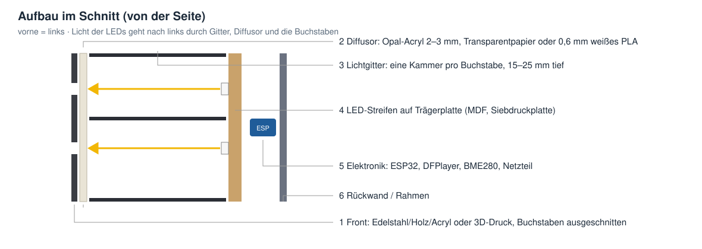
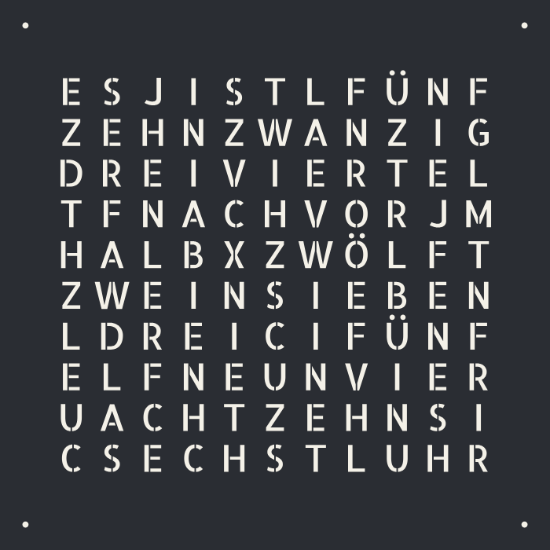
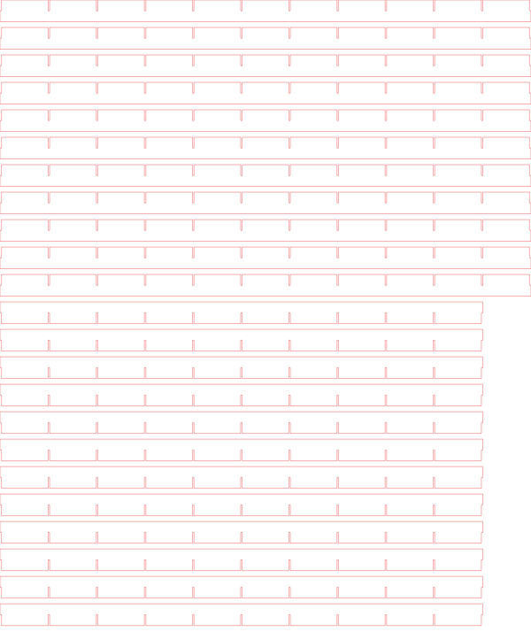
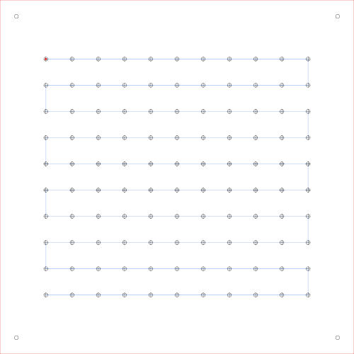
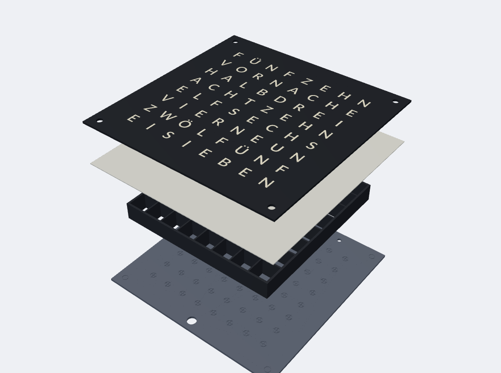

# Bauanleitung: Wortuhr selbst bauen

Diese Anleitung beschreibt den Aufbau einer Wortuhr. Sie hat zwei Wege, je nachdem, womit die Frontplatte entsteht:

- **[A: Fräse oder Laser](#a-fräse-oder-laser)**: große Uhr, z. B. Edelstahl 45 × 45 cm, Holz oder Acryl
- **[B: 3D-Drucker](#b-3d-drucker-zb-bambu-lab-a1)**: kleine Uhr, die komplett auf einen Drucker wie den Bambu Lab A1 passt (256 × 256 mm)

Alle Dateien (Front, Lichtgitter, Rückwand, STL für den Drucker) erzeugt **`tools/make_front.py`** aus jedem Layout der Firmware, siehe [Dateien erzeugen](#dateien-erzeugen).

---

## Aufbau



| Schicht | Aufgabe | Material |
|---|---|---|
| 1 Front | trägt die Buchstaben | Edelstahl 1–1,5 mm, Holz/MDF 3–6 mm, Acryl schwarz, 3D-Druck |
| 2 Diffusor | verteilt das Licht gleichmäßig über den Buchstaben | Opal-Acryl 2–3 mm, Transparentpapier, Backpapier, im 3D-Druck 0,6 mm weißes PLA |
| 3 Lichtgitter | eine Kammer pro Buchstabe, damit nichts auf die Nachbarn durchscheint | Laser: MDF/Pappe, Steckgitter aus Pappe, 3D-Druck |
| 4 LEDs | LED-Streifen WS2812B, eine LED pro Buchstabe | auf MDF oder Siebdruckplatte geklebt |
| 5 Elektronik | ESP32 D1 mini, DFPlayer, BME280, Netzteil | siehe [Schaltbild](../README.md#hardware-und-schaltbild) |
| 6 Rückwand / Rahmen | hält alles zusammen | Holz, 3D-Druck |

Tipp aus Manfred Hofmanns Bau: Die Front lässt sich mit **Magneten** in den Ecken an der Trägerplatte halten. So kommt man jederzeit an Diffusor und LEDs heran. Das Lichtgitter hat er aus **23 Streifen schwarzem Karton** (14 mm hoch) gesteckt. Dafür gibt es die Datei `steckgitter`.

## Größe wählen

Die Größe der Uhr ergibt sich aus dem **Abstand der LEDs** auf dem Streifen. Jeder Buchstabe sitzt über einer LED.

| LED-Streifen | LED-Abstand | Matrix 10 × 11 | Front (mit Rand) | passt für |
|---|---|---|---|---|
| 30 LEDs/m | 33,33 mm | 367 × 333 mm | ca. 430–450 mm | Fräse, Laser |
| 60 LEDs/m | 16,67 mm | 183 × 167 mm | ca. 217 × 200 mm | **3D-Drucker** (A1), Laser |
| 60 LEDs/m, 8 × 8 | 16,67 mm | 133 × 133 mm | ca. 167 × 167 mm | 3D-Drucker |

Eine 10 × 11-Uhr braucht **114 LEDs**: 110 Buchstaben und 4 Minuten-LEDs. In dieser Firmware kommen die 4 Minuten-LEDs **zuerst** in der Kette, danach folgen die Buchstaben in Schlangenlinie, oben links beginnend. So zeigt es die Datei `rueckwand`. Wie viele Zeilen und Spalten ein Layout hat, steht in der [Übersicht der Layouts](LAYOUTS.md).

**Stromversorgung:** 5 V mit mindestens 4 A für 114 LEDs. Sehr lange Ketten an beiden Enden einspeisen.

---

## A: Fräse oder Laser



```sh
python3 tools/make_front.py de-10-11-nero --size 450 --pitch 33.33 --letter 22 --tool 1.5 --out bau/nero-450
```

**Schablonenschrift (Stencil):** Wird eine Front durchgeschnitten (Edelstahl, Holz), würden die Innenteile von A, B, D, O, R … herausfallen. Deshalb nimmt der Generator standardmäßig eine Schablonenschrift, bei der diese Teile über kleine Stege mit der Platte verbunden bleiben. `info.txt` zeigt, wie viele lose Innenteile es gäbe.

**Fräser:** Mit `--tool` prüft der Generator, ob der Fräser in jeden Buchstaben passt. Für die Front 45 × 45 cm:

| Buchstabenhöhe | Fräser 1 mm | Fräser 1,5 mm | Fräser 2 mm |
|---|---|---|---|
| 17 mm | ✓ | X zu eng | A B E F X zu eng |
| 20–22 mm | ✓ | ✓ | B X zu eng |
| 25 mm | ✓ | ✓ | ✓ |

Edelstahl 1–1,5 mm wird meist gelasert oder mit Wasserstrahl geschnitten. Viele Online-Fertiger nehmen die **DXF-Datei** direkt an (Ebenen `AUSSENKONTUR`, `BUCHSTABEN`, `MINUTEN_LEDS`, `BEFESTIGUNG`). Im SVG ist rot = schneiden, schwarz = Buchstaben.

**Lichtgitter**, zwei Möglichkeiten:
- `lichtgitter.dxf`: Platte mit einem Loch pro Buchstabe. Mehrere Lagen MDF übereinanderlegen, bis 15–25 mm Tiefe erreicht sind.
- `steckgitter.dxf`: Streifen mit Schlitzen, die ineinandergesteckt werden. Gut aus schwarzem Karton (Laser oder Schneideplotter) oder dünnem Sperrholz. Höhe mit `--grid-height`, Materialstärke mit `--strip-thickness`.



**Trägerplatte / Rückwand** (`rueckwand.dxf`): Die Kreuze markieren die LED-Positionen, die blaue Linie zeigt die Reihenfolge der Kette (Start = roter Punkt). Am einfachsten druckt man die Datei 1 : 1 aus oder graviert sie leicht und klebt die Streifen darauf.



---

## B: 3D-Drucker (z. B. Bambu Lab A1)



```sh
# 8 × 8, ca. 167 × 167 mm
python3 tools/make_front.py de-08-08 --pitch 16.67 --font normal --out bau/8x8
# 10 × 11 Nero, ca. 217 × 200 mm
python3 tools/make_front.py de-10-11-nero --pitch 16.67 --font normal --out bau/nero-3d
```

Für den Druck darf es die normale Schrift sein (`--font normal`), weil die Innenteile der Buchstaben auf dem Diffusor sitzen.

| Datei | Farbe | Inhalt |
|---|---|---|
| `3d/front.stl` | schwarz | Frontplatte mit ausgeschnittenen Buchstaben |
| `3d/buchstaben.stl` | weiß | Buchstaben als Einsätze, bündig in der Front |
| `3d/diffusor.stl` | weiß | 0,6 mm Streuscheibe direkt hinter der Front |
| `3d/lichtgitter.stl` | schwarz | Gitter, 15 mm hoch |
| `3d/wortuhr.3mf` | – | die vier Teile oben zusammen in einem Druck |
| `3d/rueckwand.stl` | beliebig | Rückwand mit LED-Positionen, Kabelloch, 2 Aufhängelöcher (eigener Druck) |

Die Front wird **mit der Schauseite nach unten** gedruckt, damit sie die glatte oder strukturierte Oberfläche der Druckplatte bekommt. Die Dateien sind dafür bereits gespiegelt, von vorne ist die Schrift also richtig herum.

**Bambu Studio:**
1. `wortuhr.3mf` öffnen. Auf die Frage „als ein Objekt mit mehreren Teilen laden?“ mit **Ja** antworten.
2. Den Teilen Filamente zuweisen: `front` und `lichtgitter` schwarz, `buchstaben` und `diffusor` weiß. Dafür braucht man das AMS lite.
3. **Ohne AMS:** Die `buchstaben` weglassen, schwarz drucken und bei **1,6 mm Höhe** einen Filamentwechsel auf Weiß einfügen (Rechtsklick auf die Ebene in der Vorschau). Nach dem Diffusor (2,2 mm) wieder auf Schwarz wechseln. Die Buchstaben sind dann offen und leuchten durch den weißen Diffusor.
4. Einstellungen: Schichthöhe 0,2 mm, mindestens 3 Wandlinien. Texturierte PEI-Platte für eine matte Front.

Die Maße passen sich an: `--front-thickness`, `--diffusor`, `--grid-height`, `--wall`.

---

## Elektronik und Zusammenbau

1. **LEDs kleben:** Streifen nach `rueckwand` aufkleben. Zuerst die 4 Minuten-LEDs in den Ecken (oben links, oben rechts, unten rechts, unten links), dann Zeile für Zeile in Schlangenlinie. DIN-Pfeile auf dem Streifen beachten.
2. **Verdrahten:** 5 V und GND an jeder Zeile oder zumindest an beiden Enden einspeisen. Den Datenpin über die Kette führen. Pins und Bauteile stehen im [Schaltbild](../README.md#hardware-und-schaltbild).
3. **Lichtgitter** auf die LED-Platte setzen, **Diffusor** und **Front** davor.
4. **Firmware** aufspielen ([Installation](../README.md#installation)), danach unter **Anzeige → Front** das Layout und unter **Einstellungen** den LED-Typ wählen.
5. **Test:** In der Weboberfläche den Modus „Farbe“ wählen, dann leuchten alle LEDs. Danach die Uhrzeit prüfen: „ES IST … UHR“ muss genau auf den Wörtern liegen ([Welches Layout habe ich?](LAYOUTS.md#welches-layout-habe-ich)).

---

## Dateien erzeugen

```sh
pip install fonttools shapely ezdxf manifold3d trimesh
python3 tools/make_front.py --list                 # alle Layouts
python3 tools/make_front.py <layout> [Optionen]    # Dateien in bau/<layout>/
```

| Option | Standard | Bedeutung |
|---|---|---|
| `--pitch` | 33.33 | LED-Abstand in mm (30 LEDs/m = 33.33, 60 LEDs/m = 16.67) |
| `--size B [H]` | Matrix + Rand | Außenmaß der Front in mm |
| `--letter` | halber LED-Abstand | Buchstabenhöhe in mm |
| `--font` | `stencil` | `stencil` (Fräse/Laser), `normal` (3D-Druck) oder eigene `.ttf` |
| `--tool` | – | Fräserdurchmesser, prüft zu enge Buchstaben |
| `--minute-hole` | 5 | Loch für die Minuten-LEDs |
| `--minute-offset` | halber Rand | Abstand der Minuten-LEDs von der Ecke |
| `--no-minutes` | – | ohne Minuten-LEDs |
| `--mount-holes` | 0 | Befestigungslöcher (Durchmesser) in den Ecken |
| `--grid-height`, `--wall` | 15, 1.2 | Lichtgitter: Höhe und Wandstärke |
| `--strip-thickness` | 1.0 | Materialstärke für das Steckgitter |
| `--front-thickness`, `--diffusor`, `--back-thickness` | 1.6, 0.6, 2.0 | 3D-Druck |
| `--no-meander` | – | LED-Reihen nicht in Schlangenlinie |
| `--no-3d` | – | nur 2D-Dateien |

Jede Ausgabe enthält eine `info.txt` mit allen Maßen, den Positionen der Minuten-LEDs und den Prüfergebnissen.

Schriften: [Allerta Stencil](../tools/fonts/OFL-AllertaStencil.txt) und [Lato](../tools/fonts/OFL-Lato.txt), beide unter der SIL Open Font License.

## Weitere Vorlagen

Das Original-Projekt bringt fertige Dateien für bestimmte Uhren mit:
- `svg/`: Fronten 250–500 mm für einige Layouts (Text als Schrift, mit Inkscape in Pfade umwandeln)
- `vorlagen/Laser`, `vorlagen/Router`: DXF-Sätze für zwei Uhren mit Rahmen
- `vorlagen/3D-Drucker`: Hinweise zu einer gedruckten 8 × 8-Uhr
- `3D_Model/Wordclock.f3d`: Fusion-360-Modell
